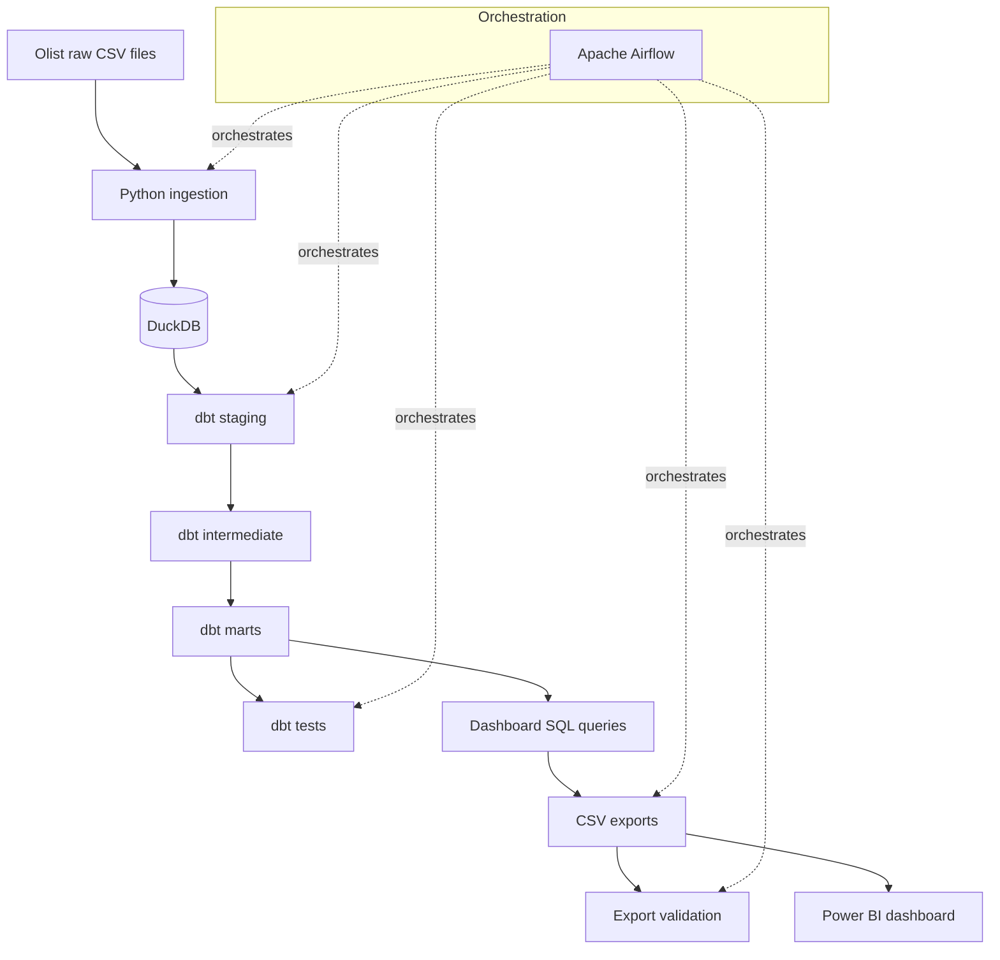
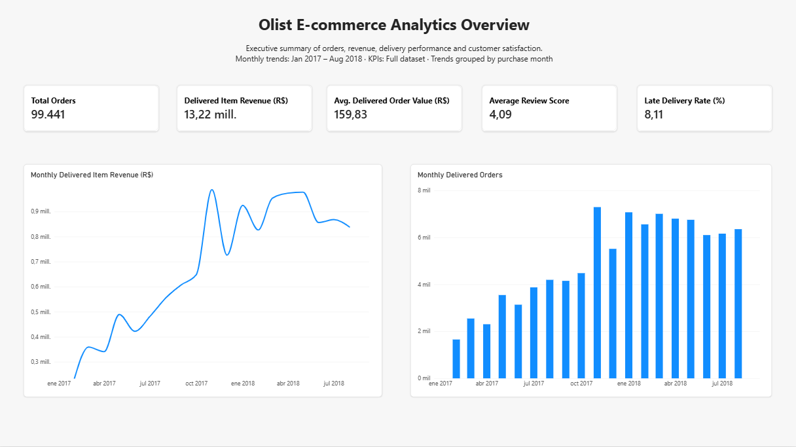
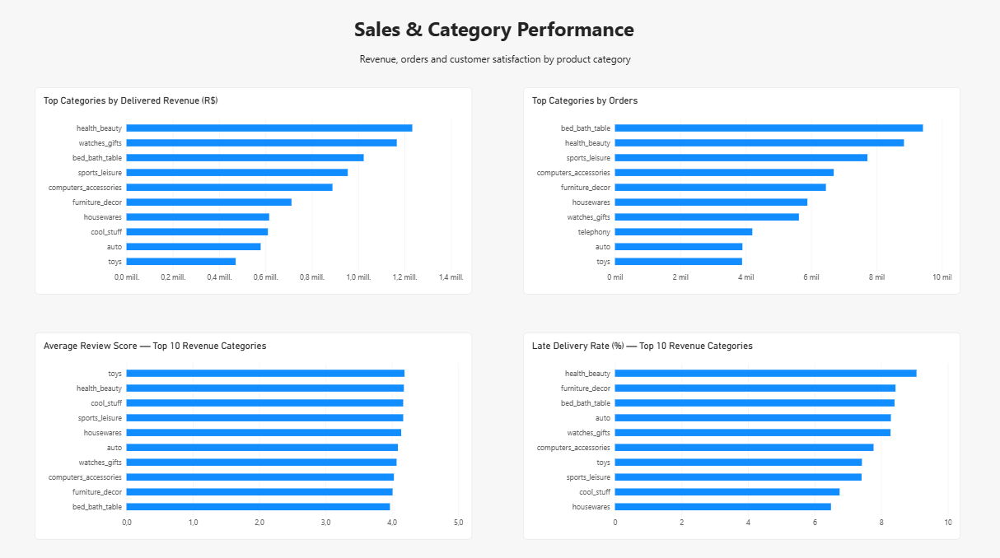
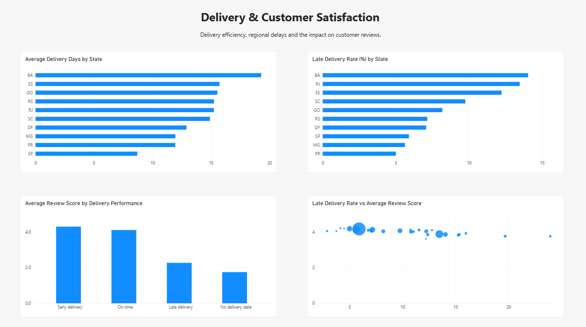
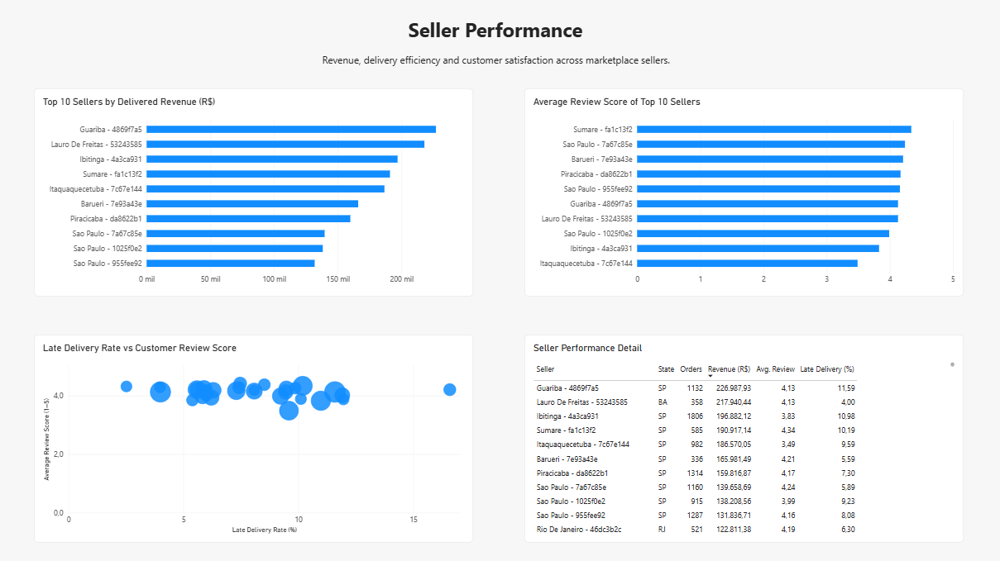
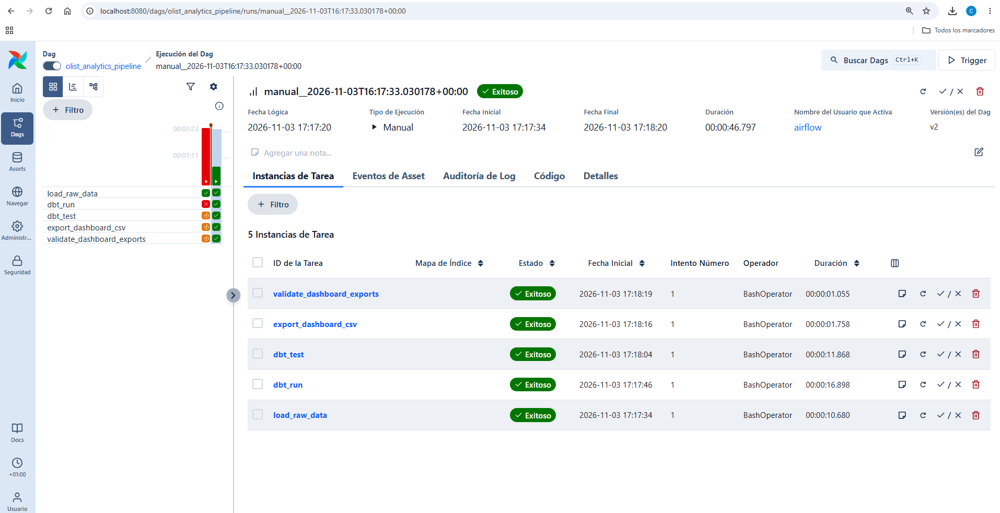

# Olist E-commerce Analytics Engineering

An end-to-end analytics engineering project built with the Brazilian E-Commerce Public Dataset by Olist. The pipeline takes raw CSV data through ingestion, analytical modeling, data quality checks and dashboard-ready exports, with Airflow orchestrating the workflow and Power BI presenting the results.

## Project overview

The project recreates a practical analytics engineering workflow for an e-commerce business. It combines Python, DuckDB, SQL, dbt, Apache Airflow and Power BI to turn raw transactional data into tested analytical models and business-facing reporting.

**What the project includes**
- Python ingestion of the source CSV files into DuckDB.
- A dbt transformation pipeline with staging, intermediate and mart layers.
- Data quality tests and documented source-data anomalies.
- Seven SQL-based datasets exported for Power BI.
- A five-task Airflow DAG to orchestrate ingestion, transformation, testing, export and validation.
- A four-page Power BI dashboard.

## Architecture



Airflow runs the tasks in this order:

`load_raw_data → dbt_run → dbt_test → export_dashboard_csv → validate_dashboard_exports`

The DAG is currently configured for manual triggering (`schedule=None`). The Airflow Compose setup is intended for local development and portfolio demonstration, not production deployment.

## Tech stack

| Area | Tools |
|---|---|
| Ingestion and validation | Python, pandas |
| Analytical database | DuckDB |
| Transformations and testing | SQL, dbt Core, dbt-duckdb |
| Orchestration | Apache Airflow 3.3.2, Docker Compose |
| Business intelligence | Power BI |
| Version control | Git, GitHub |

## Data source

The project uses the [Brazilian E-Commerce Public Dataset by Olist on Kaggle](https://www.kaggle.com/datasets/olistbr/brazilian-ecommerce).

It contains anonymized e-commerce data covering orders, customers, products, sellers, payments, reviews, geolocation and product-category translations.

The raw CSV files and generated DuckDB database are not committed to this repository. Download the dataset from Kaggle and place the nine CSV files listed below in `data/raw/` before running the pipeline.

Expected files:
- `olist_customers_dataset.csv`
- `olist_geolocation_dataset.csv`
- `olist_order_items_dataset.csv`
- `olist_order_payments_dataset.csv`
- `olist_order_reviews_dataset.csv`
- `olist_orders_dataset.csv`
- `olist_products_dataset.csv`
- `olist_sellers_dataset.csv`
- `product_category_name_translation.csv`

## Data modeling

The dbt project contains **17 models** across three layers:

| Layer | Models | Purpose |
|---|---:|---|
| Staging | 8 | Standardize source columns, types, categories and dates |
| Intermediate | 4 | Apply business logic and combine related entities |
| Marts | 5 | Provide analytical tables for reporting |

Main marts:
- `mart_orders`
- `mart_order_items`
- `mart_product_performance`
- `mart_customer_metrics`
- `mart_seller_performance`

The models support analysis of sales, products, customers, sellers, payments, reviews and delivery performance.

## Data quality

Data quality is tested throughout the dbt layers. Checks include:
- Primary-key uniqueness and not-null constraints.
- Referential integrity between related entities.
- Non-negative prices, freight and order values.
- Valid review scores.
- Customer and delivery metric consistency.
- Business-rule checks for delivered orders.

**Latest recorded dbt test result:** 96 PASS, 1 WARN, 0 ERROR (97 tests).

The warning concerns **8 orders marked as delivered without an `order_delivered_customer_date`**. It is retained and documented as a source-data anomaly rather than silently changing the raw data. See [Data Quality Notes](docs/data_quality_notes.md).

The pipeline also validates the Power BI exports by checking expected row counts, reconciling delivered item revenue across several exports, and comparing category review scores against the DuckDB mart.

## Business metrics

The dashboard and analytical models cover:
- Order volume and delivery status.
- Delivered item revenue and delivered order value.
- Average delivered order value.
- Monthly sales and product-category performance.
- Seller performance.
- Payment method distribution.
- Delivery performance by state.
- Review scores and their relationship with delivery.

**Revenue definitions used in the project**
- `delivered_item_revenue`: **R$ 13,221,498.11**. Product subtotal for delivered orders, excluding freight. This is the project's main sales KPI; it is not presented as official accounting revenue.
- `delivered_order_value`: **R$ 15,419,773.75**. Delivered order value including freight.
- `total_order_value`: **R$ 15,843,553.24**. Order value across all statuses, including freight.
- Average delivered order value: **R$ 159.83**.

These definitions are kept separate to avoid mixing product revenue, freight and orders that were not delivered.

## Key insights

The dashboard highlights several patterns in the Olist dataset:

1. **Overall performance:** The dataset contains **99,441 orders** and **R$ 13.22 million** in delivered item revenue. The average delivered order value is **R$ 159.83**, the average review score is **4.09/5**, and **8.11%** of evaluable deliveries are late.

2. **Revenue and order volume tell different stories:** **Health & Beauty** is the leading category by delivered item revenue, at approximately **R$ 1.23 million**. **Bed, Bath & Table**, however, has the highest order count, at roughly **9,500 orders**. Category performance therefore depends on whether it is measured by revenue or order volume.

3. **Delivery performance is strongly associated with customer ratings:** Average review scores are approximately **4.3/5** for early deliveries and **4.1/5** for on-time deliveries, compared with around **2.3/5** for late deliveries. Orders without a recorded delivery date have an average score of roughly **1.7/5**. These are descriptive associations and do not establish causation.

4. **Delivery performance varies by state:** Bahia (BA) has the longest average delivery time in the state comparison, at around **19 days**, and a late-delivery rate of about **14%**. São Paulo (SP) is at the other end of the comparison, with around **9 days** on average and a late-delivery rate close to **6%**.

*Note: Overall KPI figures are taken from the dashboard's displayed values. Category, delivery-group and state figures are rounded estimates read from the charts.*

## Power BI dashboard

The Power BI report contains four pages:

1. **Executive Overview** — headline KPIs and overall business performance.
2. **Sales & Category Performance** — revenue trends and product-category analysis.
3. **Delivery & Customer Satisfaction** — delivery performance and review metrics.
4. **Seller Performance** — seller-level performance analysis.

### Dashboard previews

| Executive Overview | Sales & Category Performance |
|---|---|
|  |  |

| Delivery & Customer Satisfaction | Seller Performance |
|---|---|
|  |  |

The Power BI file is available at `dashboard/olist_ecommerce_dashboard.pbix`.

Seven CSV datasets are generated in `dashboard/exports/`:
- `01_executive_kpis.csv`
- `02_monthly_revenue.csv`
- `03_category_performance.csv`
- `04_seller_performance.csv`
- `05_delivery_performance_by_state.csv`
- `06_payment_method_performance.csv`
- `07_review_delivery_relationship.csv`

These exports are generated from the SQL files in `analyses/dashboard/`. Generated exports and the local database are not tracked in Git.

## Airflow orchestration

The Airflow DAG is defined in `airflow/dags/olist_pipeline.py`. It orchestrates the full workflow and stops the run if a task fails. Tasks are configured with one retry and a two-minute retry delay.



### Run Airflow locally with Docker Compose

Prerequisites:
- Docker Desktop with WSL 2 integration enabled (for Windows/WSL users), or Docker Engine with the Compose plugin.
- The Olist CSV files downloaded and placed in `data/raw/`.
- At least 4 GB of memory available to Docker is recommended by the Airflow Compose configuration.

From the repository root:

1. Create the Airflow environment file:

   ```bash
   cd airflow
   cat > .env <<'EOF'
   AIRFLOW_UID=1000
   AIRFLOW_PROJ_DIR=.
   OLIST_PROJECT_DIR=..
   FERNET_KEY=
   EOF
   ```

2. Generate a Fernet key:

   ```bash
   python -c "import base64, os; print(base64.urlsafe_b64encode(os.urandom(32)).decode())"
   ```

   Copy the generated value into `FERNET_KEY=` in `airflow/.env`. Keep this file private; it is intentionally excluded from Git.

3. Build the custom Airflow image and initialize the metadata database and administrator account:

   ```bash
   docker compose build
   docker compose up airflow-init
   ```

4. Start the Airflow services:

   ```bash
   docker compose up -d
   ```

5. Open [http://localhost:8080](http://localhost:8080) and sign in. The default local-development credentials in the Compose configuration are `airflow` / `airflow`; change them if you adapt this setup for any shared environment.

6. Find `olist_analytics_pipeline` in the Airflow UI and trigger it manually. Confirm that all five tasks complete successfully.

7. Stop the services when finished:

   ```bash
   docker compose down
   ```

Run Compose commands from the `airflow/` directory. The Compose file mounts the repository root into the containers at `/opt/olist_analytics`, where the DAG runs the ingestion, dbt, export and validation scripts.

## Run the ingestion and dbt steps locally

The following commands are for running the Python ingestion script and dbt separately, outside Airflow. They assume the project dependencies are installed and a local dbt profile named `olist_analytics` is configured to use DuckDB and the project database.

From the repository root, create and activate a virtual environment if needed, then install the project requirements:

```bash
python -m venv .venv
source .venv/bin/activate
pip install -r requirements.txt
```

Load the raw CSV files:

```bash
python scripts/load_raw_olist.py
```

Run dbt from the repository root:

```bash
dbt run
dbt test
```

Generate the dashboard exports and validate them:

```bash
python scripts/export_dashboard_queries.py
python scripts/validate_dashboard_exports.py
```

For the local dbt commands, configure the `olist_analytics` profile in `~/.dbt/profiles.yml` with a DuckDB output pointing to the repository's `olist_analytics.duckdb` file. The Airflow-specific profile is already provided in `airflow/dbt/profiles.yml` and points to the database path mounted inside the containers.

## Repository structure

```text
.
├── analyses/
│   └── dashboard/             # SQL queries used for Power BI exports
├── airflow/
│   ├── dags/                  # Airflow DAG
│   ├── dbt/                   # dbt profile used inside Airflow
│   ├── Dockerfile
│   ├── docker-compose.yaml
│   └── requirements.txt
├── dashboard/
│   ├── screenshots/           # Dashboard and Airflow screenshots
│   └── olist_ecommerce_dashboard.pbix
├── docs/
│   └── data_quality_notes.md
├── models/
│   ├── staging/
│   ├── intermediate/
│   └── marts/
├── scripts/
│   ├── load_raw_olist.py
│   ├── export_dashboard_queries.py
│   └── validate_dashboard_exports.py
├── tests/
├── dbt_project.yml
└── requirements.txt
```

## Project status

The end-to-end portfolio workflow is implemented and has been run successfully through Airflow. The DAG is manually triggered in the current local Docker Compose setup; it is not a scheduled or production deployment.

## What this project demonstrates

- Building an end-to-end analytics engineering workflow.
- Ingesting raw data into an analytical database with Python and DuckDB.
- Structuring transformations into dbt staging, intermediate and mart layers.
- Testing data quality and documenting source-data anomalies.
- Orchestrating dependent pipeline tasks with Apache Airflow.
- Validating analytical exports before they are consumed by Power BI.
- Translating business questions into metrics and dashboard reporting.
